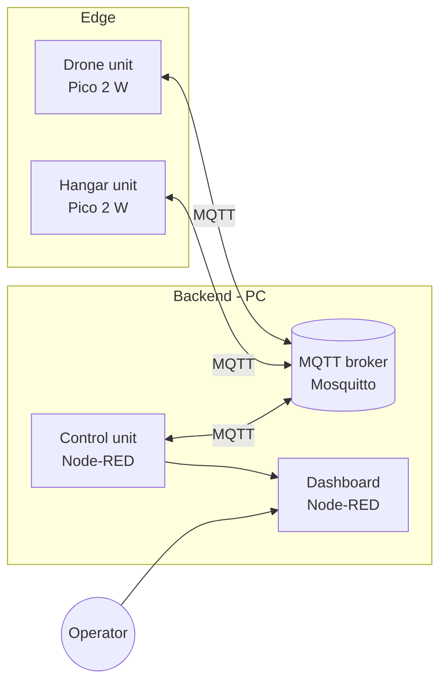
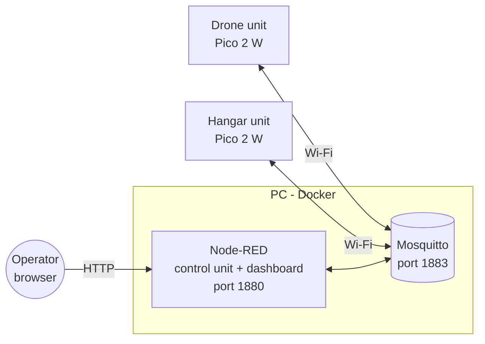

# Architecture
## Overview

The system is composed of three main subsystems that communicate only through an MQTT broker:

- **Drone unit**: a Raspberry Pi Pico 2 W that simulates an autonomous inspection drone. It runs the flight state machine, requests permission to take off and land, and publishes its state and telemetry. A tilt sensor detects the inclination of the board, while the flight data (speed, acceleration, altitude, ground distance, distance from the hangar, mission progress) and the battery level are simulated.
- **Hangar unit**: a Raspberry Pi Pico 2 W that acts as the drone's ground station, sheltering it between missions. It opens and closes its door with a servo motor, monitors the environment (temperature, humidity and water/steam), and shows its state through LEDs and a display. It is the safety authority of the system: it authenticates the drone and grants or denies every take-off and landing request based on the local environmental conditions.
- **Backend**: a set of services running on a PC.
    - The **MQTT broker** (Mosquitto) relays all messages between the components.
    - The **control unit** observes the whole system and forwards the operator's commands (start mission, recall, emergency closure, alarm reset) to the devices, which may refuse them.
    - The **dashboard** shows the real-time state of the drone and the hangar, and lets the operator issue commands.

Drone and hangar coordinate directly through the broker: the backend supervises the system but is not involved in safety-critical decisions, so the two devices keep working even if it is unavailable.

## Architectural style

The system follows a **publish/subscribe** architecture built around a central MQTT broker. Components never address each other directly: each one publishes messages on topics and subscribes to the topics it is interested in.

This style fits the system for three reasons:

- **Decoupling**: drone and hangar do not need to know each other's network address, and a device can be replaced by a software simulator without changing the others.
- **Many-to-many communication**: the same message reaches every interested component. The control unit and the dashboard observe all the traffic without the devices being aware of them.
- **Broker features**: retained messages give a late subscriber the last known state of each device, and the Last Will mechanism notifies everyone when a device disconnects unexpectedly.

MQTT has no native request/response interaction, which the take-off and landing requests need. It is built on top of publish/subscribe with dedicated request and response topics, correlated by a request identifier and bounded by timeouts (see [Protocol](protocol.md)).

## Distribution of control

Safety-critical decisions are taken **at the edge, by the hangar**: opening the door, authenticating the drone, and granting
or denying take-off and landing. The hangar evaluates every request against its own sensor readings, and it does not need the
backend to do so.

The **backend only supervises**. Commands are requests, not orders: each device checks them against its current state and
may refuse them with a reason.

As a consequence, drone and hangar keep coordinating directly through the broker even when the control unit or the dashboard 
are unavailable. Only monitoring and manual commands are lost. If the broker itself fails, no mission can start or end, 
but the hangar keeps the door closed and the drone holds its position until the connection is restored.

## Technology choices

| Option | Decision | Reason |
| --- | --- | --- |
| MQTT | **Adopted** | Publish/subscribe with a broker, QoS levels, retained messages and Last Will cover the needs of the system. It crosses firewalls, since every component acts as a client of the broker. |
| CoAP | Rejected | It offers native request/response with confirmable messages, but no publish/subscribe and no broker: the control unit would have to know and poll each device. It would also lose retained state and Last Will. It is designed for low-power, lossy networks, which is not the case here. |
| Thread / Matter | Rejected | Thread requires an IEEE 802.15.4 radio, which the Pico 2 W does not have (its radio supports only Wi-Fi and Bluetooth). Matter targets interoperability between smart-home products; its SDK is heavy and it adds nothing for a two-device industrial prototype. |
| Wi-Fi | **Adopted** | Built into the Pico 2 W and supports TCP/IP directly. Its limits (range of about 150 m, high power consumption) are acceptable for a prototype; a real system would use a cellular or long-range radio link. |

## Security

MQTT provides little security by itself, so it is added at two levels.

**Broker level**

- Anonymous access is disabled: every client authenticates to the broker with its own username and password.
- Access control lists (ACLs) restrict each client to the topics required by its role, so a client cannot impersonate another one:

| Client | Can publish | Can subscribe |
| --- | --- | --- |
| `hangar` | `dib/hangar/#` | `dib/drone/#`, `dib/cmd/hangar` |
| `drone` | `dib/drone/#` | `dib/hangar/#`, `dib/cmd/drone` |
| `controlunit` | `dib/cmd/#` | `dib/#` |

**Application level**

Before evaluating a landing request, the hangar authenticates the drone with an HMAC-based challenge-response that resists replay attacks (see [Protocol](protocol.md)).

**Known limitation:** traffic is not encrypted (no TLS), so credentials travel in clear text on the local network. This is accepted for a prototype on an isolated network and listed among the future improvements.

## Deployment view

| Component | Runs on | Notes |
| --- | --- | --- |
| MQTT broker | PC, Docker container | Exposed on port 1883 to the local network. |
| Control unit and dashboard | PC, Node-RED container | Reaches the broker through the Docker network; dashboard on port 1880. |
| Hangar unit | Raspberry Pi Pico 2 W | Connects to the broker over Wi-Fi using the PC's LAN address. |
| Drone unit | Raspberry Pi Pico 2 W | Same as the hangar. |
| Simulators (testing only) | PC, Python | Can replace either device, using the same protocol. |

All components must be on the same local network.