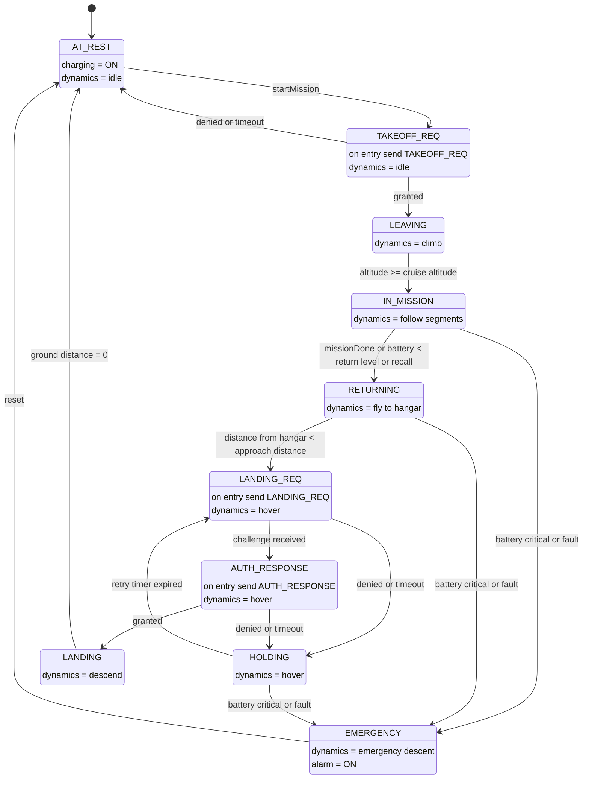
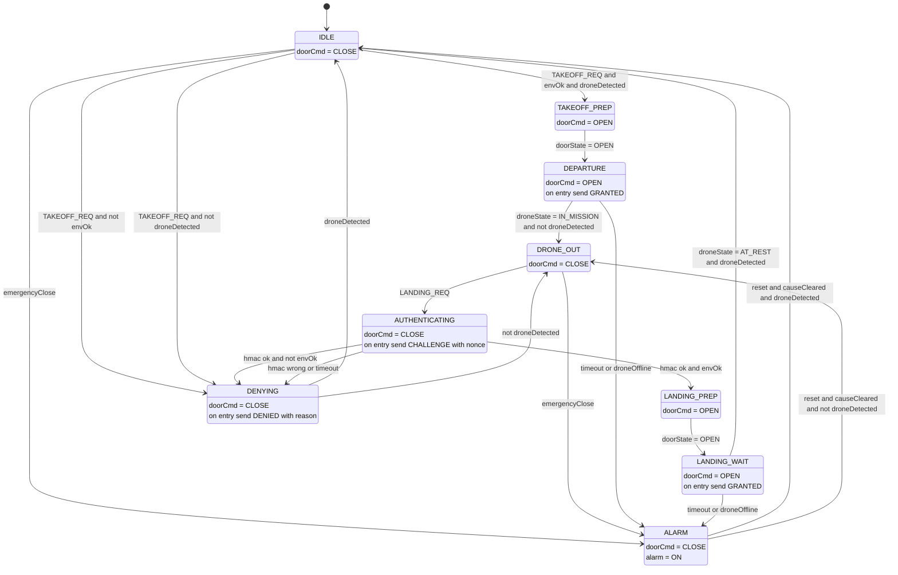
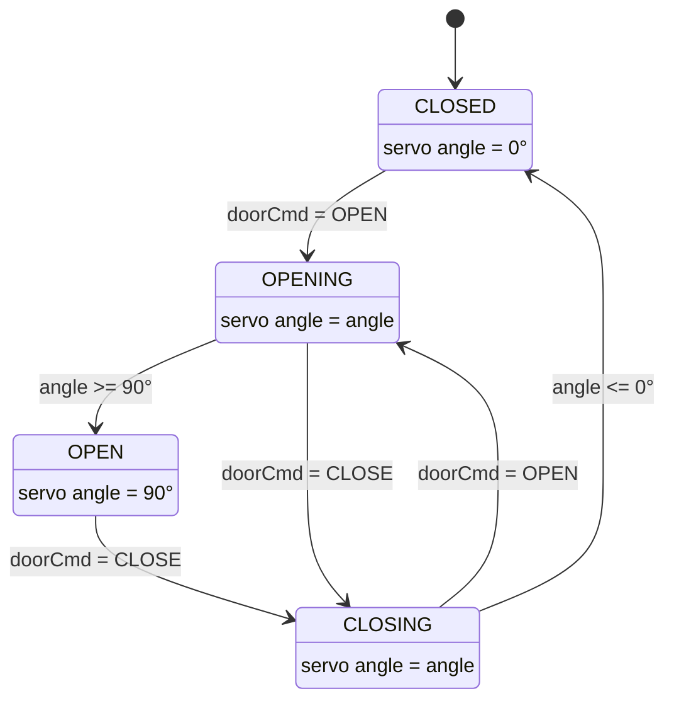
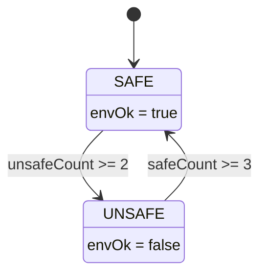
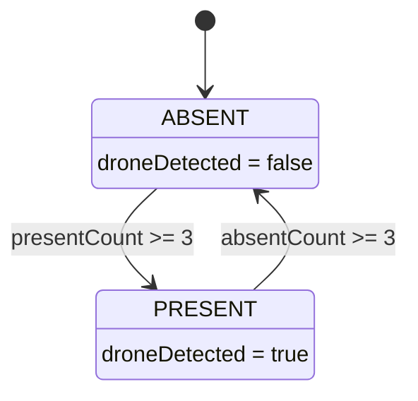
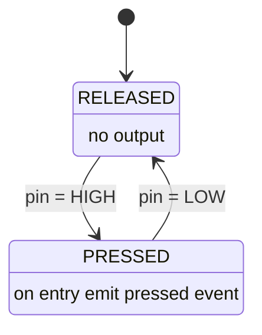
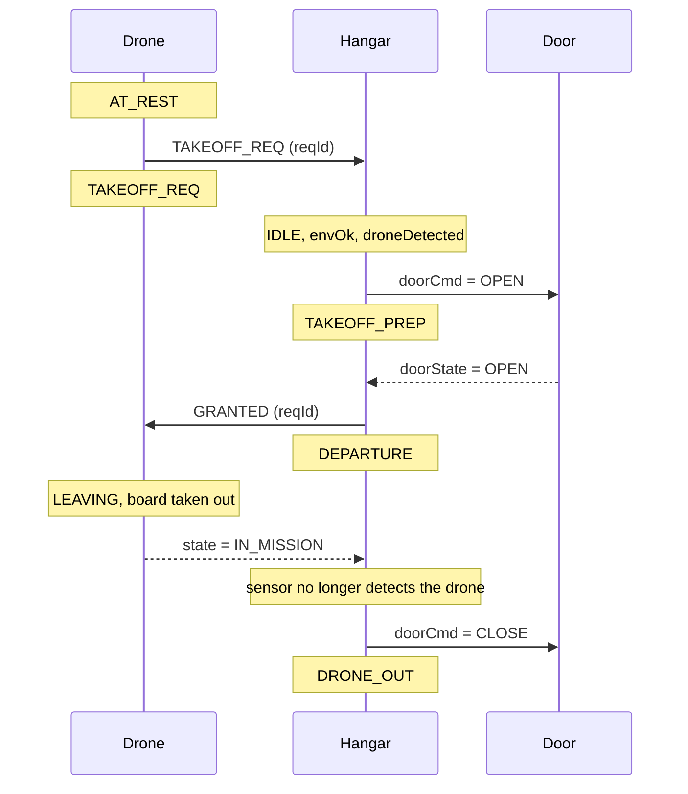
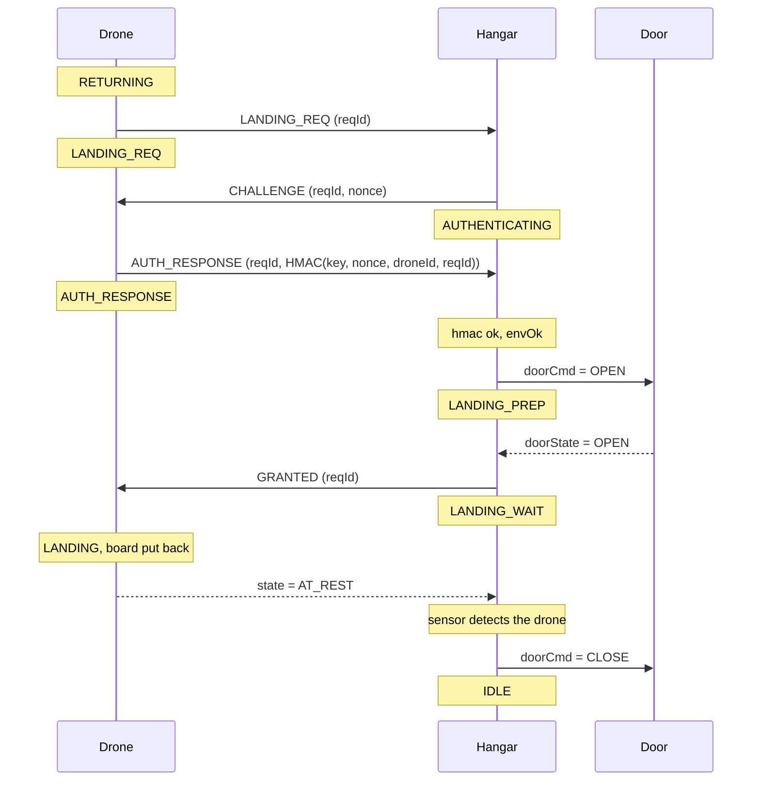
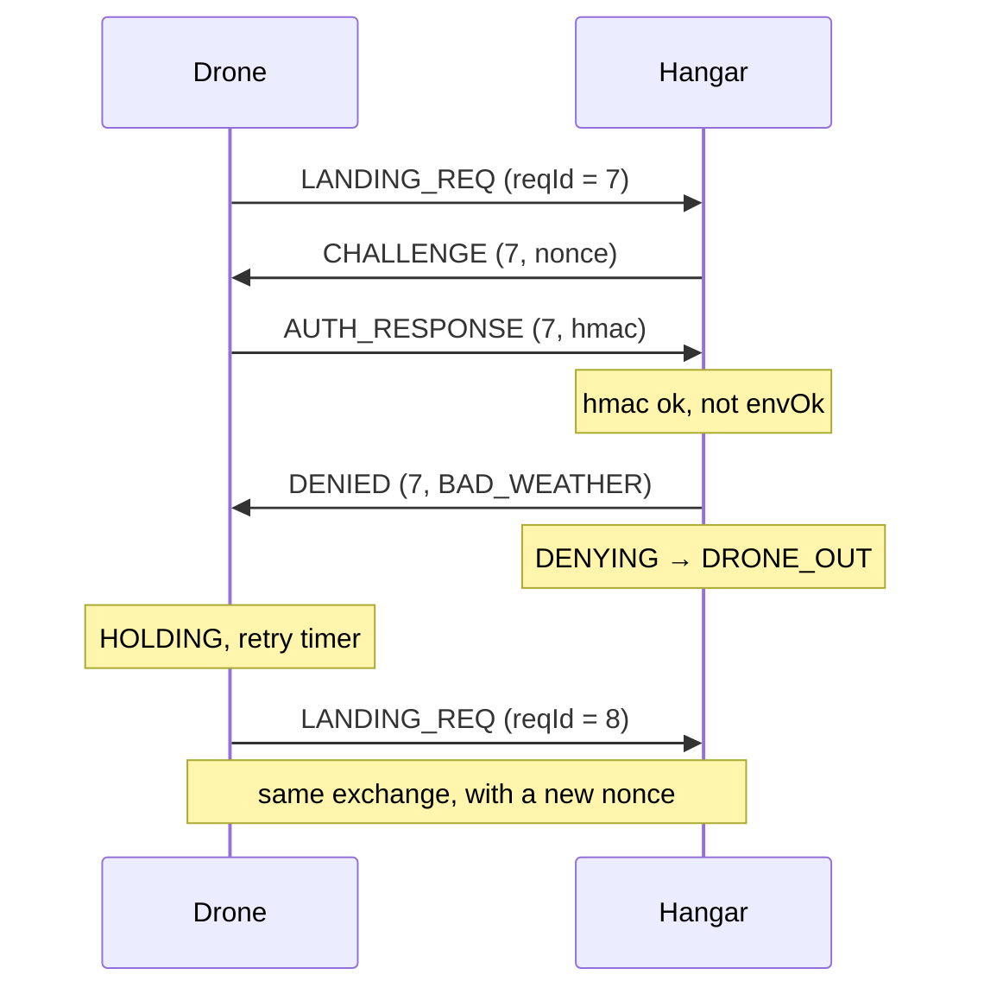

# Behaviour

This chapter models the behaviour of the system with **finite state machines (FSMs)**. It defines the state machines of each
device, how they interact with each other, and why they are designed as **synchronous Moore machines**.

## 1. Modelling approach

### 1.1 Discrete and continuous components

The system contains both kinds of components described in the theory:
- **discrete components** evolve through atomic changes (a door is closed or opening, a request is granted or denied). They are modelled with FSMs;
- **continuous components** evolve smoothly: the flight kinematics (speed, acceleration, altitude, distance) and the battery charge.
  They are not FSMs: they are modelled as simple equations, integrated with a fixed time step dt, e.g. v(t + dt) = v(t) + a · dt.
### 1.2 Extended FSMs

All machines are **extended FSMs (EFSMs)**: besides the discrete state, they use variables (timers, counters, the door angle,
the current reqId). This keeps the number of discrete states small. Timeouts, for example, are counters of reactions, not additional states.

### 1.3 Globally asynchronous, locally synchronous

The two devices run on two different microcontrollers, with no shared clock. **Their FSMs are therefore concurrent and asynchronous
with respect to each other**: they coordinate only by exchanging messages, and a message produced by one machine is an input event for the other (section 5).

On each device, instead, the machines are synchronous (time-triggered): they react periodically, with a fixed period.
Time is part of the specification: timeouts, the gradual movement of the door, sensor sampling, the time step of the flight simulation.
This scheme is known as **GALS (globally asynchronous, locally synchronous)**.

Several synchronous FSMs run concurrently on the same device, one per task, each with its own period (section 6).

## 2. Moore machines

### 2.1 The choice

All FSMs in the system are designed as **Moore machines**. In the diagrams, the outputs are written inside each state, and the transitions are labelled only with their guards.

Outputs are of two kinds:
- **level outputs**, held for the whole time the machine is in a state: the door command, the servo angle, the LED pattern, the active flight dynamics, the state published on MQTT;
- **messages**, emitted once when the machine *enters* a state (entry actions, as in UML statecharts): a message is a
  discrete event, so sending it at every reaction while in the state would be wrong.
### 2.2 Why Moore and not Mealy

1. **The published state is the output.** Each device publishes its current state on a retained MQTT topic. With a Moore
   machine that state fully describes what the device is doing, so other components can rely on it. For example, the hangar
   does not need a separate *"I have landed"* message: it observes that the drone's state has become `AT_REST`. The protocol
   gets simpler, and the dashboard shows exactly what drives the outputs.
2. **Idempotent outputs after a failure.** Since every output is bound to a state, it can be reproduced at any time from
   the state alone.
3. **Simpler implementation and tests.** Each state is a class with an `onEnter()` method (messages) and an output function (levels),
   following the _State pattern_. A unit test checks a single fact: *"after reaching state X, the outputs are Y"*.
   **Trade-offs accepted.** A Moore machine reacts to an input one reaction later than the equivalent Mealy machine, and sometime
   needs a few extra transient states (e.g. `DENYING`, section 4.1). With a period of 100 ms, the extra latency is at most 100
   ms per step, well within the 500 ms of NFR-6.

## 3. Drone

### 3.1 Flight FSM

Every state publishes its name on `dib/drone/state` when entered. The transitions to `EMERGENCY` drawn from `IN_MISSION`, `RETURNING` and `HOLDING` apply to **every flying state** (`LEAVING`, `LANDING_REQ`, `AUTH_RESPONSE`, `LANDING` included). They are omitted from the diagram for readability.

| State | Meaning |
| --- | --- |
| `AT_REST` | Inside the hangar, recharging. Initial state. |
| `TAKEOFF_REQ` | Take-off requested, waiting for the hangar's decision. |
| `LEAVING` | Leaving the hangar and climbing to cruise altitude. During this phase the board is taken out of the hangar. |
| `IN_MISSION` | Flying the mission segments. Reaching this state tells the hangar that the drone is out. |
| `RETURNING` | Flying back towards the hangar. |
| `LANDING_REQ` | Landing requested, hovering, waiting for the authentication challenge. |
| `AUTH_RESPONSE` | Challenge answered, waiting for the decision. |
| `HOLDING` | Landing denied or not answered: hovering until the retry timer expires. |
| `LANDING` | Descending into the hangar. During this phase the board is put back into the hangar. Reaching `AT_REST` tells the hangar that the drone has landed. |
| `EMERGENCY` | Critical anomaly: emergency descent in the safe area (EC-6). Left only by an operator reset after recovery. |

| Variable | Use |
| --- | --- |
| `reqId` | Identifier of the current request, used to match the answer. |
| `timer` | Counts reactions, for timeouts and for the retry delay. |
| `segment`, `progress` | Current mission segment and travelled fraction. |
| `battery`, `altitude`, `groundDistance`, `distanceFromHangar`, `tilt` | Read from the continuous models. |
| `fault` | Set by the anomaly input (section 3.2). |

The guard `startMission` is true only if the command passed the dispatcher, which also checks that the battery is above the minimum take-off level. Otherwise it answers `BATTERY_LOW`.

The board is physically moved during take-off and landing, so the simulated `LEAVING` and `LANDING` phases last long enough to do it by hand (5–8 s each).

### 3.2 Anomaly input

The tilt switch injects a fault to demonstrate the emergency behaviour: tilting the board makes the drone enter `EMERGENCY`.
The switch is a digital input that bounces like a button, so it is read through the debouncing FSM of section 4.5, and its
event sets the `fault` variable read by the flight FSM. Roll and pitch in the telemetry remain simulated, since the switch
reports only *tilted* or *not tilted*.

### 3.3 Status LED

An RGB LED shows the drone state. Like the hangar indicator, its colour is a function of the flight FSM state.

| Flight state | Colour |
| --- | --- |
| `AT_REST` | green |
| `TAKEOFF_REQ`, `LANDING_REQ`, `AUTH_RESPONSE` | yellow blinking |
| `LEAVING`, `LANDING` | yellow |
| `IN_MISSION`, `RETURNING` | blue |
| `HOLDING` | blue blinking |
| `EMERGENCY` | red blinking |

## 4. Hangar

The hangar runs five FSMs: the **controller**, which takes decisions; the **door**, which executes them; the **environment monitor**,
which conditions the temperature and humidity readings; the **presence monitor**, which detects whether the drone is inside;
the **button**, which detects the local alarm reset. A sixth component, the **status indicator**, maps the controller state
to the traffic light and the display.

### 4.1 Controller FSM

Every state publishes its name on `dib/hangar/state` when entered.

| State | Meaning |
| --- | --- |
| `IDLE` | Drone inside, door closed. |
| `TAKEOFF_PREP` | Take-off accepted, door opening. |
| `DEPARTURE` | Door fully open, take-off granted, waiting for the drone to be out. |
| `DRONE_OUT` | Drone in mission, door closed. |
| `AUTHENTICATING` | Landing requested, challenge sent, waiting for the answer. |
| `LANDING_PREP` | Landing accepted, door opening. |
| `LANDING_WAIT` | Door fully open, landing granted, waiting for the drone to land. |
| `DENYING` | Transient: sends the denial with its reason, then returns at the next reaction. |
| `ALARM` | Door closed, every request denied with `ALARM_ACTIVE` until a reset. |

At start-up the controller enters `IDLE`; at its first reaction, if the presence monitor does not detect the drone, it moves
to `DRONE_OUT` (EC-14).

**Denial reasons** set when entering `DENYING`:

| Transition | Reason |
| --- | --- |
| take-off with `not envOk` | `BAD_WEATHER` |
| take-off with `not droneDetected` | `DRONE_NOT_PRESENT` |
| landing with `hmac ok and not envOk` | `BAD_WEATHER` |
| landing with `hmac wrong` | `AUTH_FAILED` |
| landing with `timeout` | `AUTH_TIMEOUT` |

**Alarm causes** set when entering `ALARM`:

| Transition | Cause |
| --- | --- |
| `emergencyClose` | `EMERGENCY_CLOSE` |
| `timeout` in `DEPARTURE` | `DEPARTURE_TIMEOUT` |
| `timeout` in `LANDING_WAIT` | `LANDING_TIMEOUT` |
| `droneOffline` | `DRONE_OFFLINE` |

The guard `causeCleared` is always true for `EMERGENCY_CLOSE`, since a human decision is revoked by a human. For the other
causes it is true when the drone is online again and its state agrees with the presence sensor.

| Variable | Use |
| --- | --- |
| `reqId`, `nonce` | Current request and authentication challenge. |
| `reason`, `cause` | Reason of the denial, cause of the alarm. |
| `timer` | Timeouts in `AUTHENTICATING`, `DEPARTURE` and `LANDING_WAIT`. |
| `emergencyPending` | Emergency closure requested while the drone is passing through the door (EC-15). |

Inputs: `envOk` comes from the environment monitor (4.3), `droneDetected` from the presence monitor (4.4), `doorState` from
the door FSM (4.2). `droneState` and `droneOffline` come from the drone's state topic and Last Will. `reset` comes from the
dashboard or from the local button (4.5). Requests, the challenge answer and operator commands come from the dispatcher.

**Two independent confirmations.** Every passage through the door needs both the state declared by the drone and the physical
detection by the presence sensor. If they do not agree before the timeout, the hangar enters the alarm state (EC-17).

### 4.2 Door FSM

In `OPENING` and `CLOSING` the variable `angle` increases or decreases by a fixed step at every reaction (e.g. 3° every 50 ms, a full movement in 1.5 s). The door state and its position in % are published at every change.

The door FSM is a pure executor: it never decides whether opening is safe. That decision belongs to the controller.

### 4.3 Environment monitor FSM

Raw readings are noisy, and a value near a threshold would make the classification flip at every sample. The monitor applies **input conditioning**: a change of classification requires several consecutive readings that agree.

`unsafeCount` and `safeCount` count consecutive readings that violate, or respect, the temperature and humidity thresholds of the safety policy, and are reset when a reading disagrees. A failed or invalid reading counts as unsafe (EC-12). Leaving the unsafe classification requires more readings than entering it, so the system is cautious.

### 4.4 Presence monitor FSM

An infrared sensor pointed at the parking spot detects whether the drone is inside. Its output can flicker (reflections,
ambient light, the drone being moved), so a change is accepted only after several consecutive readings that agree.

`presentCount` and `absentCount` count consecutive readings in which the sensor sees, or does not see, the drone. With a
period of 100 ms, a change is confirmed in 300 ms. The initial state is corrected within the first reactions, so the
controller knows where the drone is right after a reboot (EC-14). Every change is published together with the hangar state,
so the dashboard can show it.

### 4.5 Button FSM (debouncing)

A local button on the hangar resets the alarm. It is the recovery channel when the backend is not reachable: without it,
the hangar would stay in `ALARM` until the dashboard comes back. A press is accepted only while the controller is in `ALARM`,
and only if the cause of the alarm has been cleared; otherwise the display shows `CAUSE_NOT_CLEARED`. Presses in any other
state are ignored. The same machine reads the drone's tilt switch (3.2).

Debouncing follows from the choice of the period, as described in the theory:

- the sampling period is **50 ms**, longer than the typical bouncing period (~20 ms), so the bounces of a single press are
  not observed as separate presses;
- the period is shorter than the **minimum event separation time** of a human press (a press lasts well over 100 ms), so
  no press is lost.
### 4.6 Status indicator

The status indicator is not an independent decision maker: its output is a function of the controller state. It is a Moore machine whose only internal state is the blinking phase, which toggles every 250 ms. It drives the traffic light and the 128×32 display.

| Controller state | Green | Yellow | Red | Display |
| --- | --- | --- | --- | --- |
| `IDLE` | on | off | off | state, temperature, humidity |
| `TAKEOFF_PREP`, `LANDING_PREP` | off | blinking | off | "DOOR OPENING" |
| `DEPARTURE`, `LANDING_WAIT` | off | on | off | "TAKE-OFF" / "LANDING" |
| `DRONE_OUT` | blinking | off | off | "DRONE OUT", temperature, humidity |
| `AUTHENTICATING` | off | blinking | off | "AUTHENTICATING" |
| `DENYING` | off | off | on | denial reason |
| `ALARM` | off | off | blinking | alarm cause |

## 5. Interaction between drone and hangar

The two flight-critical interactions are request/response exchanges, matched by `reqId` and bounded by timeouts on both sides (NFR-3).

### 5.1 Take-off

### 5.2 Landing with authentication

### 5.3 Landing denied

## 6. Tasks and periods

Each FSM is executed by one task of a **cooperative scheduler**. The continuous models are tasks too, since they advance
with a fixed time step.

| Device | Task | Executes | Period |
| --- | --- | --- | --- |
| Hangar | Comm | MQTT client, dispatcher, message queue | 50 ms |
| Hangar | Controller | Controller FSM (4.1) | 100 ms |
| Hangar | Door | Door FSM (4.2) | 50 ms |
| Hangar | EnvMonitor | Environment monitor FSM (4.3) | 2 s |
| Hangar | Presence | Presence monitor FSM (4.4) | 100 ms |
| Hangar | Button | Button FSM (4.5) | 50 ms |
| Hangar | Status | Status indicator (4.6) | 250 ms |
| Drone | Comm | MQTT client, dispatcher, message queue | 50 ms |
| Drone | Flight | Flight FSM (3.1) | 100 ms |
| Drone | FlightModel | Kinematics, `dt` = 100 ms | 100 ms |
| Drone | Battery | Battery model | 1 s |
| Drone | Anomaly | Button FSM on the tilt switch (3.2) | 50 ms |
| Drone | StatusLed | Status LED (3.3) | 250 ms |
| Drone | Telemetry | Publishes telemetry | 500 ms |

The choice of the periods follows the rule from the theory: *the largest period that still guarantees that no event is lost and that latencies stay acceptable.*

- **100 ms** for the decision-making FSMs gives a worst-case reaction latency well below the 500 ms of NFR-6.
- **100 ms** for the presence sensor confirms a change in 300 ms, far quicker than the time needed to move the drone in or out.
- **50 ms** for the door gives a smooth movement. For the button and the tilt switch it filters bounces while staying below the MEST of a press.
- **2 s** for the environment: the weather changes slowly, and the DHT11 sensor must not be read more than once per second.
- **The scheduler runs at 50 ms**, the greatest common divisor of all periods.

**Messages and the MEST.** For physical inputs, choosing a period shorter than the MEST guarantees that no event is lost.
Network messages give no such guarantee: two messages can arrive a few milliseconds apart. For this reason the MQTT callback
never touches the FSMs: it pushes each message into a queue, and the dispatcher delivers the queued events to the machines
at their next reaction. The queue is the boundary between the asynchronous world of the network and the synchronous world of the FSMs.