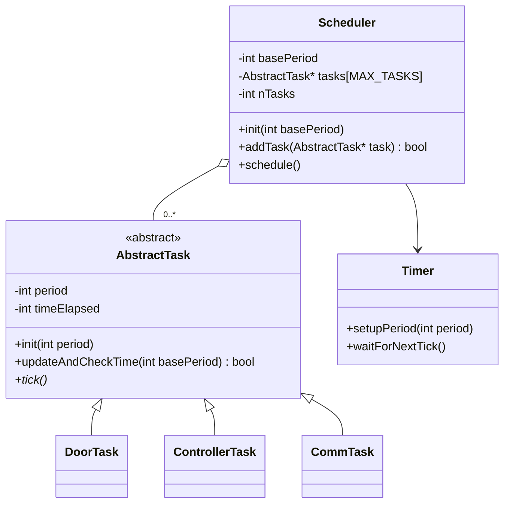
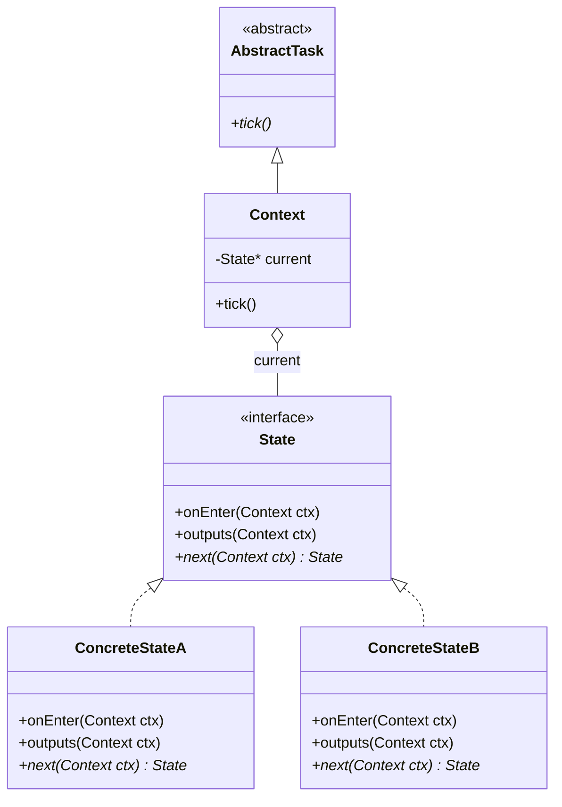
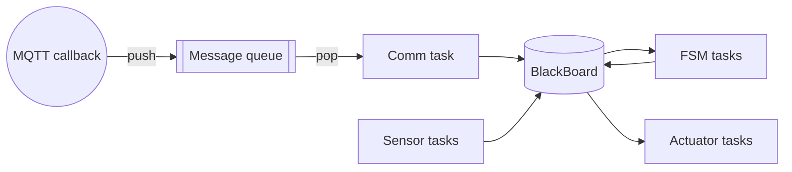
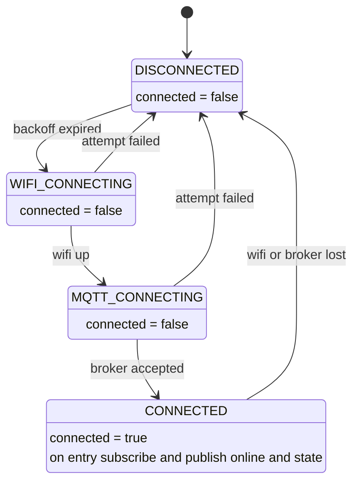
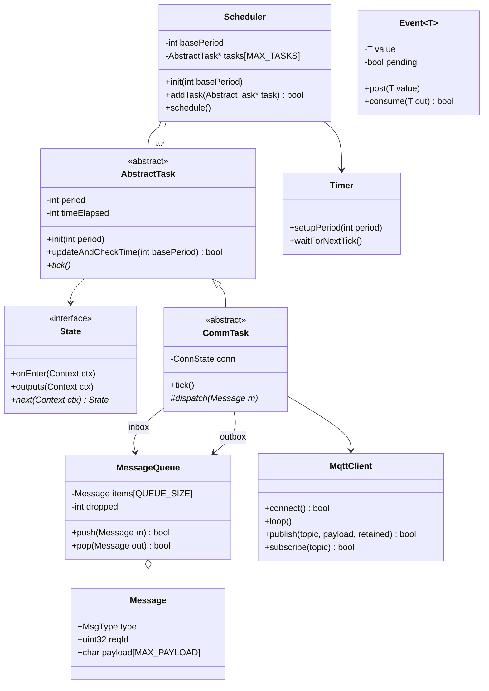

# Control

This chapter describes the control architecture shared by the `hangar-unit` and the `drone-unit`.

## Task

The firmware of each unit follows a **task-based architecture**:

- the behaviour of the unit is decomposed into a set of concurrent tasks;
- each task is a well-defined and independent unit of work, with its own period;
- the behaviour of each task is described by a synchronous FSM (see [Behaviour](../behaviour.md)).

All tasks extend the abstract class `AbstractTask`, which stores the period of the task and the time elapsed since its last execution. Each concrete task implements `tick()`, which performs one step of its FSM.

The tasks run on a single core, so their concurrency is logical: they do not run in parallel, but their executions are interleaved by the scheduler.

## Scheduler

Tasks are executed by a **cooperative scheduler** with a round-robin policy:

- the scheduler has a base period *p*, equal to the greatest common divisor of the periods of the tasks (50 ms);
- the period of every task is a multiple of *p*;
- at every period *p*, the scheduler updates the elapsed time of each task and calls `tick()` only on the tasks whose period has expired, always in the same order;
- a timer provides the periodic behaviour: the scheduler waits for the next tick of the timer before starting a new round.

For example, with *p* = 50 ms the door task (50 ms) runs at every round, the controller (100 ms) every second round, and the environment monitor (2 s) every 40 rounds.



## State pattern

The discrete components of each unit are modelled as FSMs (see [Behaviour](../behaviour.md)). The continuous models (flight kinematics, battery) and the hardware drivers are not FSMs.

The larger machines are implemented with the **State pattern**: each state is a class, and the task that runs the machine holds a reference to the current state. Since the machines are Moore machines, each state class defines three operations:

- `next()`: evaluates the guards on the inputs and returns the next state (or itself);
- `onEnter()`: emits the messages of the state, once, when the state is entered;
- `outputs()`: applies the level outputs of the state (door command, LEDs, flight dynamics).



The context is the task itself: each call to `tick()` performs one reaction of the machine.

```cpp
void Context::tick() {
  State* nextState = current->next(*this);
  if (nextState != current) {
    current = nextState;
    current->onEnter(*this);
  }
  current->outputs(*this);
}
```

Timers and counters (timeouts, retry delays) are variables of the context, incremented at every reaction, as in an extended FSM.

All state objects are created once, at start-up; no memory is allocated while the system is running. Small machines with two or three states (button, presence monitor) are implemented with a plain `enum` and a `switch`, which is simpler and equivalent.

## Communication between tasks

Tasks never call each other: they communicate through a shared object, `BlackBoard`, passed by reference to each task when
it is created. A task reads its inputs from `BlackBoard` and writes its outputs into it.

Shared data are of two kinds:

- **levels** describe the current situation (e.g. whether the environment is safe, the position of the door). They are 
overwritten at every update, and readers always use the latest value;
- **events** describe something that happened once (e.g. a button press, a request received). The producer sets a flag,
and the consumer clears it after handling the event, so that each event is handled exactly once. Where events can arrive
faster than the consumer's period, a queue replaces the flag.

The only code that runs outside the scheduler is the MQTT callback. It never writes `BlackBoard` directly: it pushes the
received message into a queue, which the communication task empties at its next execution.



A value written by a task becomes visible to the tasks that run after it in the same round, or in the next round. Since 
all machines are Moore machines, their outputs do not depend on the inputs of the same reaction, so the order in which 
the scheduler runs the tasks does not affect the correctness of the system.

## MQTT integration

Each unit has a **communication task** (`CommTask`), the only part of the firmware that talks to the network. It connects to Wi-Fi and to the broker, receives and sends messages, and keeps the rest of the system independent from MQTT. The common behaviour is implemented in an abstract `CommTask`; each unit extends it with its own topics and message handling.

### Receiving messages

The MQTT library delivers incoming messages through a callback, which runs outside the scheduler. To keep the tasks synchronous, the callback does only one thing: it copies the message into the **inbox**, a fixed-size queue, and returns.

At each execution, `CommTask` empties the inbox and passes every message to the **dispatcher**, which:

1. parses the JSON envelope and discards malformed messages or messages with an unknown protocol version;
2. discards messages not accepted in the current state of the unit (e.g. a request while another one is in progress, a response with an unknown `reqId`) or answers them directly (e.g. `INVALID_STATE` for an operator command);
3. turns every accepted message into a blackboard update: a level (e.g. the drone's state) or an event (e.g. a take-off request).

The acceptance rules depend on the unit and are described in [Hangar](hangar.md) and [Drone](drone.md).

If the inbox is full, the new message is dropped and a counter is incremented. With QoS 1 and the request timeouts of the protocol, a dropped message is recovered by a retry.

### Sending messages

Tasks never publish directly. The messages emitted on entry into a state are placed in the **outbox**, a fixed-size queue in the blackboard, and `CommTask` publishes them at its next execution. `CommTask` also publishes:

- the state of the unit (retained) whenever it changes;
- periodic data (telemetry, environment) at the period set for each unit;
- the `online` status right after every connection.

### Connection management

Connecting to Wi-Fi and to the broker can take seconds, which would block every other task. The connection is therefore managed by a small FSM inside `CommTask`, which makes at most one connection attempt per execution:



- After a failed attempt, the delay before the next one doubles, up to a maximum (e.g. 1 s, 2 s, 4 s … 30 s), so that a missing network does not waste the processor.
- When connecting, the client registers its Last Will (`offline` on `dib/<unit>/status`).
- On entering `CONNECTED`, it subscribes to its topics, publishes `online` and republishes its current state, so that the other components are up to date.
- While disconnected, the unit keeps working autonomously: the FSMs continue to run, and messages placed in the outbox are discarded. The protocol does not depend on them being delivered later, thanks to the timeouts and the retained state.

The `connected` flag is written in the blackboard, so other tasks can show it (e.g. on the display).

## Class diagram

The following classes are shared by the hangar and the drone.



| Class | Role |
| --- | --- |
| `AbstractTask` | Base class of every task: period, elapsed time, `tick()`. |
| `Scheduler` | Runs the tasks whose period has expired, once per base period. |
| `Timer` | Provides the base period of the scheduler. |
| `State` | Interface of the states of the larger FSMs (State pattern). |
| `Event<T>` | One-shot event in the blackboard: posted by one task, consumed once by another. |
| `Message`, `MessageQueue` | Fixed-size message and queue, used for the inbox and the outbox. |
| `MqttClient` | Thin wrapper around the MQTT library, so that the rest of the code does not depend on it. |
| `CommTask` | Connection management, inbox and outbox handling; `dispatch()` is implemented by each unit. |

All objects are created at start-up, and all buffers have a fixed size: no memory is allocated while the system is running.