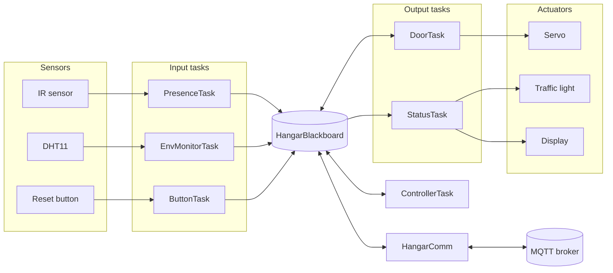
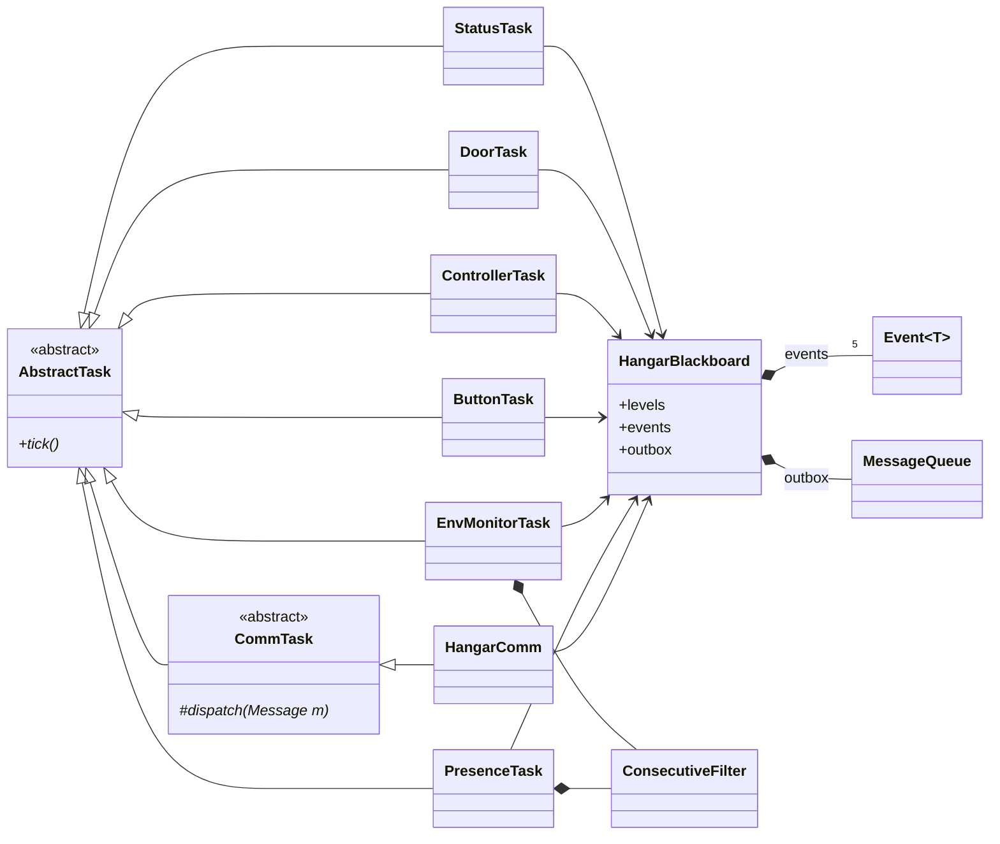
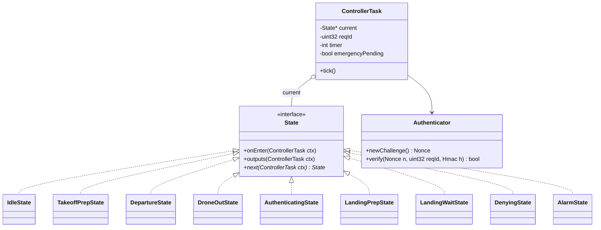
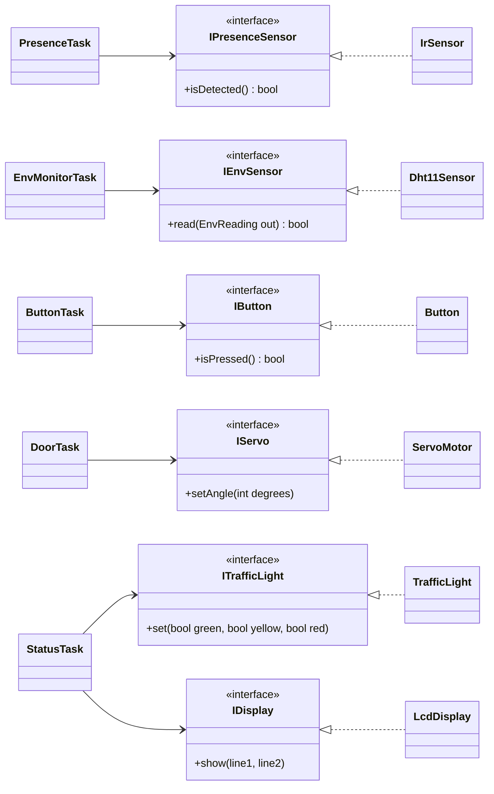

# Hangar

This chapter describes how the control architecture of [Control](control.md) is applied to the hangar unit. The behaviour of each state machine is defined in [Behaviour](../behaviour.md); here we describe how the parts are organised and how they exchange data.

## 1. Overview

The hangar firmware is a set of periodic tasks that never call each other: they communicate only through a shared `HangarBlackboard`. Input tasks read the sensors and write their values into the blackboard; the controller takes decisions on those values; output tasks drive the actuators; `HangarComm` connects the blackboard to the MQTT broker.

Only `ControllerTask` takes decisions. The other tasks either translate a physical signal into a value (input tasks), or a value into a physical action (output tasks), or messages into values and back (`HangarComm`).

## 2. Tasks

| Task | Period | Behaviour | Reads | Writes |
| --- | --- | --- | --- | --- |
| `HangarComm` | 50 ms | Connection FSM, dispatcher ([Control](control.md)) | `hangarState`, `doorState`, `doorPosition`, environment, `droneDetected`, outbox | `droneState`, `droneOnline`, `connected`, request events |
| `PresenceTask` | 100 ms | Presence monitor FSM (4.4) | IR sensor | `droneDetected` |
| `EnvMonitorTask` | 2 s | Environment monitor FSM (4.3) | DHT11 | `envOk`, `temperature`, `humidity` |
| `ButtonTask` | 50 ms | Button FSM (4.5) | reset button | `resetFromButton` |
| `ControllerTask` | 100 ms | Controller FSM (4.1) | inputs and events above, `doorState` | `doorCmd`, `hangarState`, `reason`, `cause`, outbox |
| `DoorTask` | 50 ms | Door FSM (4.2) | `doorCmd` | `doorState`, `doorPosition`, servo |
| `StatusTask` | 250 ms | Status indicator (4.6) | `hangarState`, `reason`, `cause`, environment | traffic light, display |

The section numbers in the *Behaviour* column refer to [Behaviour](../behaviour.md).

**Order of execution.** The tasks are registered in the scheduler in the order of the table: communication and inputs first, then the controller, then the outputs. In this way, within the same round:

- the controller decides on the freshest inputs, including the messages just received;
- the actuators apply the commands the controller has just produced.

A command therefore reaches the door in the same round in which it was decided. The only one-round delay concerns outgoing messages: the controller places them in the outbox after `HangarComm` has run, so they are published at the next round, at most 50 ms later.

**Base period.** The scheduler runs with a base period of 50 ms, the greatest common divisor of the task periods. The timer keeps a fixed grid of ticks: if a round overruns, the missed ticks are skipped and counted, without shifting the following ones.

## 3. Blackboard

`HangarBlackboard` holds all the data shared by the tasks. It is created once at start-up and passed by reference to every task. Every field has exactly **one writer**.

### Levels

Levels describe the current situation and are overwritten at every update.

| Field | Writer | Readers |
| --- | --- | --- |
| `droneDetected` | `PresenceTask` | `ControllerTask`, `HangarComm` |
| `envOk`, `temperature`, `humidity` | `EnvMonitorTask` | `ControllerTask`, `StatusTask`, `HangarComm` |
| `doorState`, `doorPosition` | `DoorTask` | `ControllerTask`, `StatusTask`, `HangarComm` |
| `doorCmd` | `ControllerTask` | `DoorTask` |
| `hangarState`, `reason`, `cause` | `ControllerTask` | `StatusTask`, `HangarComm` |
| `droneState`, `droneOnline` | `HangarComm` | `ControllerTask` |
| `connected` | `HangarComm` | `StatusTask` |

### Events

Events describe something that happened once. They are posted by one task and consumed exactly once by another.

| Event | Posted by | Consumed by |
| --- | --- | --- |
| `request` (type, `reqId`) | `HangarComm` | `ControllerTask` |
| `authResponse` (`reqId`, HMAC) | `HangarComm` | `ControllerTask` |
| `emergencyClose` | `HangarComm` | `ControllerTask` |
| `resetFromDashboard` | `HangarComm` | `ControllerTask` |
| `resetFromButton` | `ButtonTask` | `ControllerTask` |

The reset has two sources, the dashboard and the local button, so it is modelled as two separate events: a single shared flag would have two writers. The controller handles them in the same way.

### Outbox

The outbox is a fixed-size queue of outgoing messages (`CHALLENGE`, `GRANTED`, `DENIED`). `ControllerTask` adds a message when it enters a state that emits one; `HangarComm` empties the queue and publishes the messages. In this way only `HangarComm` depends on MQTT.

The state of the hangar, the door and the environment are not placed in the outbox: `HangarComm` reads them directly from the levels and publishes them when they change.

## 4. Class diagrams

The classes of the hangar are shown in three diagrams, each answering a different question: how the tasks share data, how the controller is structured, and how the code reaches the hardware. The shared classes (`AbstractTask`, `CommTask`, `Event`, `MessageQueue`, `State`) are described in [Control](control.md).

### 4.1 Tasks and blackboard

Every task extends `AbstractTask` and holds a reference to the single `HangarBlackboard`. `HangarComm` extends the abstract `CommTask`, adding the hangar's topics and dispatching rules. The input tasks that need to filter noisy readings use a `ConsecutiveFilter`.

The fields of the blackboard are listed in section 3.

### 4.2 Controller

The controller FSM is implemented with the State pattern. `ControllerTask` is the context: it holds the current state and the variables of the extended FSM (current request, timer, pending emergency closure). Each of the nine states of the controller FSM is a class implementing `State`. The states are stateless objects, created once at start-up: everything that must be remembered between reactions lives in `ControllerTask`.

`Authenticator` generates the challenge and verifies the drone's answer. It is used only by `AuthenticatingState`, through the controller.

### 4.3 Hardware abstraction

Tasks never access pins or device libraries directly. Each device is reached through an interface, implemented by a driver class that wraps the hardware.

This separation has two benefits:

- **testability**: since tasks depend only on interfaces, they compile in the `native` environment and are tested on the PC with fake devices (e.g. a fake servo that records the angles it receives);
- **replaceability**: changing a device (e.g. a different display) requires a new driver, not a change in the tasks.

### 4.4 Where the classes live

| Folder | Content | Depends on Arduino |
| --- | --- | --- |
| `common/src/` | Shared classes: `AbstractTask`, `Scheduler`, `ITimer`, `Event`, `MessageQueue`, `State`, `ConsecutiveFilter` | no |
| `hangar-unit/lib/logic/` | Tasks, controller states, `Authenticator`, `HangarBlackboard`, device interfaces | no |
| `hangar-unit/src/` | Drivers (`IrSensor`, `Dht11Sensor`, `ServoMotor`…), `ArduinoTimer`, `HangarComm`, `main.cpp` | yes |

Only the last folder includes `Arduino.h`; everything else is compiled and unit-tested in the `native` environment.