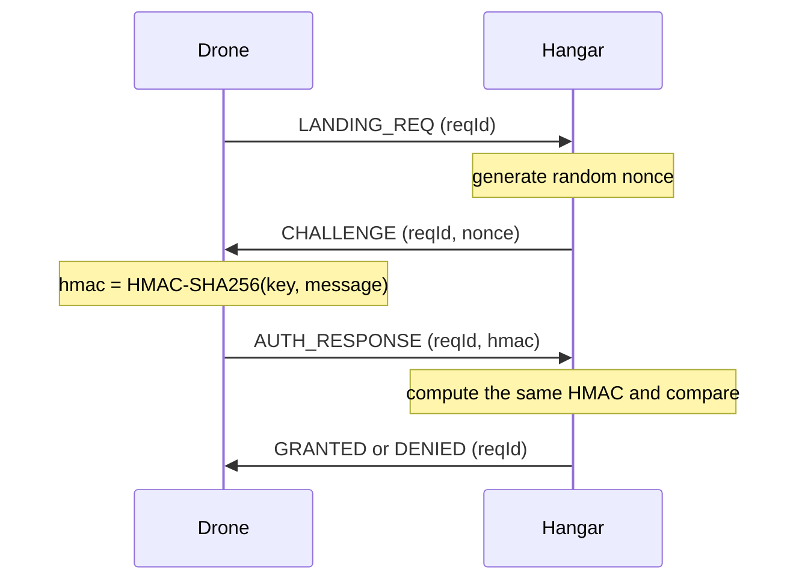

# Protocol

## Topic structure

All topics start with `dib/` and follow the pattern `dib/<device>/<kind>`. Topics are grouped below by publisher.

### Hangar topics

| Topic | Subscriber | QoS | Retained |
| --- | --- | --- | --- |
| `dib/hangar/state` | control unit | 1 | yes |
| `dib/hangar/door` | control unit | 0 | yes |
| `dib/hangar/environment` | control unit | 0 | yes |
| `dib/hangar/response` | drone, control unit | 1 | no |
| `dib/hangar/cmd-reply` | control unit | 1 | no |
| `dib/hangar/status` | drone, control unit | 1 | yes |

### Drone topics

| Topic | Subscriber | QoS | Retained |
| --- | --- | --- | --- |
| `dib/drone/state` | hangar, control unit | 1 | yes |
| `dib/drone/telemetry` | control unit | 0 | no |
| `dib/drone/request` | hangar, control unit | 1 | no |
| `dib/drone/cmd-reply` | control unit | 1 | no |
| `dib/drone/status` | hangar, control unit | 1 | yes |

### Control unit topics

| Topic | Subscriber | QoS | Retained |
| --- | --- | --- | --- |
| `dib/cmd/drone` | drone | 1 | no |
| `dib/cmd/hangar` | hangar | 1 | no |

### Topic descriptions

| Topic | Content |
| --- | --- |
| `state` | Current state of the device's main state machine. |
| `door` | Door state (`CLOSED`, `OPENING`, `OPEN`, `CLOSING`) and position in %. |
| `environment` | Temperature, humidity, water/steam detection and the safe/unsafe classification with its reason. |
| `telemetry` | Battery, speed, acceleration, altitude, ground distance, distance from the hangar, tilt, mission progress, error code. |
| `request` | Messages from the drone to the hangar: `TAKEOFF_REQ`, `LANDING_REQ`, `AUTH_RESPONSE`. |
| `response` | Messages from the hangar to the drone: `CHALLENGE`, `GRANTED`, `DENIED`. |
| `cmd` | Operator commands forwarded by the control unit. |
| `cmd-reply` | Result of a command: accepted, or refused with a reason. |
| `status` | `online` when the device connects; `offline` published by the broker as the device's Last Will. |

The message type (e.g. `TAKEOFF_REQ` or `LANDING_REQ`) is a field of the JSON payload, not part of the topic name.

### Design rules

- **Retained** messages are used for topics that describe the *current situation* (state, door, environment, status), so that a component connecting late immediately receives the last known value.
- **Non-retained** messages are used for *events* (requests, responses, commands, replies): delivering an old request to a component that has just connected would make it look like a new one. Telemetry is not retained either, because it changes continuously.
- **QoS 1** (at least once) is used where losing a message would block or confuse the system: states, requests, responses, commands. Duplicates are discarded thanks to the request identifier.
- **QoS 0** (at most once) is used for periodically sampled data: if a sample is lost, the next one arrives shortly after.

## Message format

All messages are JSON objects with the same envelope:

```json
{
  "v": 1,
  "type": "TAKEOFF_REQ",
  "src": "drone",
  "ts": 128450,
  "reqId": 3482,
  "data": { }
}
```

| Field | Type | Meaning |
| --- | --- | --- |
| `v` | integer | Protocol version, currently `1`. |
| `type` | string | Message type (see below). |
| `src` | string | Sender: `drone`, `hangar` or `controlunit`. |
| `ts` | integer | Sender's uptime in milliseconds. The Pico has no real-time clock, so the backend adds its own reception time for the log. |
| `reqId` | integer | Only in requests, responses and commands: identifies the exchange (see [Request/response](#requestresponse)). |
| `data` | object | Type-specific content. Omitted when empty. |

Units are fixed: metres, metres per second, metres per second squared, degrees, degrees Celsius, percent.

### State and status

`dib/hangar/state`
```json
{ "v": 1, "type": "STATE", "src": "hangar", "ts": 90210,
  "data": { "state": "ALARM", "cause": "DRONE_OFFLINE" } }
```
`cause` is present only in the `ALARM` state.

`dib/drone/state`
```json
{ "v": 1, "type": "STATE", "src": "drone", "ts": 90180,
  "data": { "state": "IN_MISSION" } }
```

`dib/<device>/status`
```json
{ "v": 1, "type": "STATUS", "src": "drone", "ts": 1520,
  "data": { "online": true } }
```

### Data

`dib/hangar/door`
```json
{ "v": 1, "type": "DOOR", "src": "hangar", "ts": 91050,
  "data": { "state": "OPENING", "position": 45 } }
```

`dib/hangar/environment`
```json
{ "v": 1, "type": "ENVIRONMENT", "src": "hangar", "ts": 92000,
  "data": { "temperature": 18.5, "humidity": 62, "water": false, "safe": true } }
```

`dib/drone/telemetry`
```json
{ "v": 1, "type": "TELEMETRY", "src": "drone", "ts": 92300,
  "data": { "battery": 74, "charging": false, "speed": 8.2, "acceleration": 0.4,
            "altitude": 30.0, "groundDistance": 30.0, "distanceFromHangar": 112.5,
            "roll": 2.1, "pitch": -1.4, "progress": 46, "segment": 3, "segments": 6,
            "error": null } }
```

### Requests (`dib/drone/request`)

```json
{ "v": 1, "type": "TAKEOFF_REQ", "src": "drone", "ts": 128450, "reqId": 3482 }
```
```json
{ "v": 1, "type": "LANDING_REQ", "src": "drone", "ts": 412900, "reqId": 3483 }
```
```json
{ "v": 1, "type": "AUTH_RESPONSE", "src": "drone", "ts": 413050, "reqId": 3483,
  "data": { "hmac": "9f2c…e71a" } }
```

### Responses (`dib/hangar/response`)

```json
{ "v": 1, "type": "CHALLENGE", "src": "hangar", "ts": 389120, "reqId": 3483,
  "data": { "nonce": "4be1a09c37d2f5e8b06a1c9d2e7f4a31" } }
```
```json
{ "v": 1, "type": "GRANTED", "src": "hangar", "ts": 390800, "reqId": 3483 }
```
```json
{ "v": 1, "type": "DENIED", "src": "hangar", "ts": 389200, "reqId": 3483,
  "data": { "reason": "BAD_WEATHER" } }
```

### Commands and replies

`dib/cmd/drone`, `dib/cmd/hangar`
```json
{ "v": 1, "type": "CMD", "src": "controlunit", "ts": 1731690000, "reqId": 57,
  "data": { "command": "START_MISSION" } }
```
Commands: `START_MISSION`, `RECALL` (drone); `EMERGENCY_CLOSE`, `RESET_ALARM` (hangar).

`dib/<device>/cmd-reply`
```json
{ "v": 1, "type": "CMD_REPLY", "src": "drone", "ts": 95400, "reqId": 57,
  "data": { "accepted": false, "reason": "BATTERY_LOW" } }
```

## Request/response

MQTT has no request/response interaction, so it is built on top of publish/subscribe: requests travel on `dib/drone/request`, responses on `dib/hangar/response`, and the two are matched by the `reqId` field.

**Request identifiers.** The drone generates a new `reqId` for every take-off or landing request, from a counter initialised with a random value at boot, so that identifiers are not reused after a reboot. All the messages of one exchange carry the same `reqId`: a landing request, its challenge, the authentication response and the final decision.

**Matching and duplicates.**

- The drone accepts only responses whose `reqId` matches its current request, and ignores all the others (old, duplicated or not addressed to it).
- The hangar processes one request at a time. A request that arrives while another one is in progress, or a duplicate of the current one, is ignored.
- Since every message is matched by `reqId`, receiving one twice (possible with QoS 1) has no effect.

**Timeouts.** Every wait is bounded, so no device waits forever:

| Who waits | For what | Timeout | On expiry |
| --- | --- | --- | --- |
| Drone | `GRANTED` / `DENIED` after `TAKEOFF_REQ` | 5 s | back to `AT_REST`, reason `NO_RESPONSE` |
| Drone | `CHALLENGE` after `LANDING_REQ` | 3 s | `HOLDING`, reason `NO_RESPONSE` |
| Drone | `GRANTED` / `DENIED` after `AUTH_RESPONSE` | 5 s | `HOLDING`, reason `NO_RESPONSE` |
| Drone | retry delay in `HOLDING` | 10 s | sends a new `LANDING_REQ` |
| Hangar | `AUTH_RESPONSE` after `CHALLENGE` | 3 s | `DENIED`, reason `AUTH_TIMEOUT` |
| Hangar | drone out after `GRANTED` (take-off) | 15 s | `ALARM`, cause `DEPARTURE_TIMEOUT` |
| Hangar | drone landed after `GRANTED` (landing) | 20 s | `ALARM`, cause `LANDING_TIMEOUT` |

The drone's timeouts after a request are longer than the door movement (about 1.5 s), because the hangar sends `GRANTED` only when the door is fully open. The values are defaults and can be configured.

## Authentication handshake

Before evaluating a landing request, the hangar checks that the request really comes from the registered drone. Hangar and drone share a secret key; the drone proves it knows the key without ever sending it.



**Computation.**

- **Key:** 32 random bytes, stored in a configuration header that is excluded from version control (`secrets.h`).
- **Nonce:** 16 bytes from the hardware random number generator of the RP2350, sent as a lowercase hex string.
- **Message:** the UTF-8 string `<nonce>|<droneId>|<reqId>`, e.g. `4be1a09c37d2f5e8b06a1c9d2e7f4a31|drone|3483`.
- **Answer:** `HMAC-SHA256(key, message)`, sent as a lowercase hex string (64 characters).

**Verification.** The hangar computes the same HMAC and compares the two values in constant time, so the comparison time reveals nothing about the expected value. Each nonce allows a single attempt:

- match → the hangar evaluates the weather and grants or denies the landing;
- mismatch → `DENIED` with `AUTH_FAILED`;
- no answer within 3 s → `DENIED` with `AUTH_TIMEOUT`.

**Why it resists replay.** The nonce is new and random for every landing request, so a captured `AUTH_RESPONSE` matches only the challenge it was computed for. Sent again later, it is checked against a different nonce and fails (EC-8). Including `droneId` and `reqId` in the message ties the answer to one drone and one exchange.

**Limitation.** The key is shared and stored in both firmwares, so anyone who can read a device's flash can obtain it. This is acceptable for the prototype. A real system would use per-device keys in secure storage.
## Denial reasons

Every refusal carries a `reason` field with one of the following codes, so that the dashboard can show it and the tests can check it.

### Take-off request

Sent by the hangar in a `DENIED` message.

| Code           | Meaning                                                               |
|----------------|-----------------------------------------------------------------------|
| `BAD_WEATHER`  | Humidity, temperature are above the safety threshold.                 |
| `ALARM_ACTIVE` | The hangar is in the alarm state and accepts no requests until reset. |


### Landing request

Sent by the hangar in a `DENIED` message. All the take-off codes also apply, plus:

| Code | Meaning |
| --- | --- |
| `AUTH_FAILED` | The answer to the challenge is wrong. |
| `AUTH_TIMEOUT` | The drone did not answer the challenge in time. |

### Timeouts on the drone side

Not sent by anyone: set by the drone when the hangar does not answer, and published in its telemetry.

| Code | Meaning |
| --- | --- |
| `NO_RESPONSE` | No answer to a take-off or landing request within the timeout. |

### Operator commands

Sent by the drone or the hangar in a `cmd-reply` message.

| Code | Meaning |
| --- | --- |
| `INVALID_STATE` | The command is not accepted in the current state (e.g. *Recall* while at rest). |
| `BATTERY_LOW` | *Start mission* refused: battery below the minimum take-off level. |
| `CAUSE_NOT_CLEARED` | *Reset alarm* refused: the cause of the alarm is still present. |